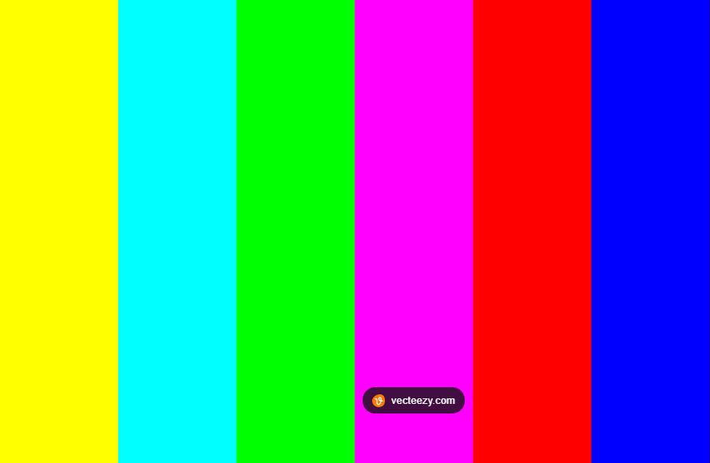
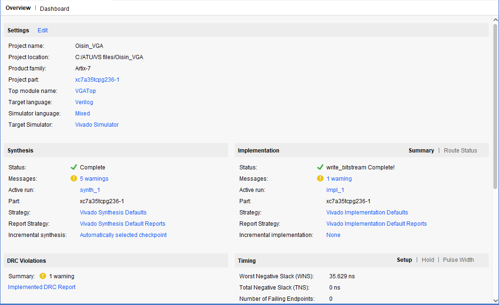
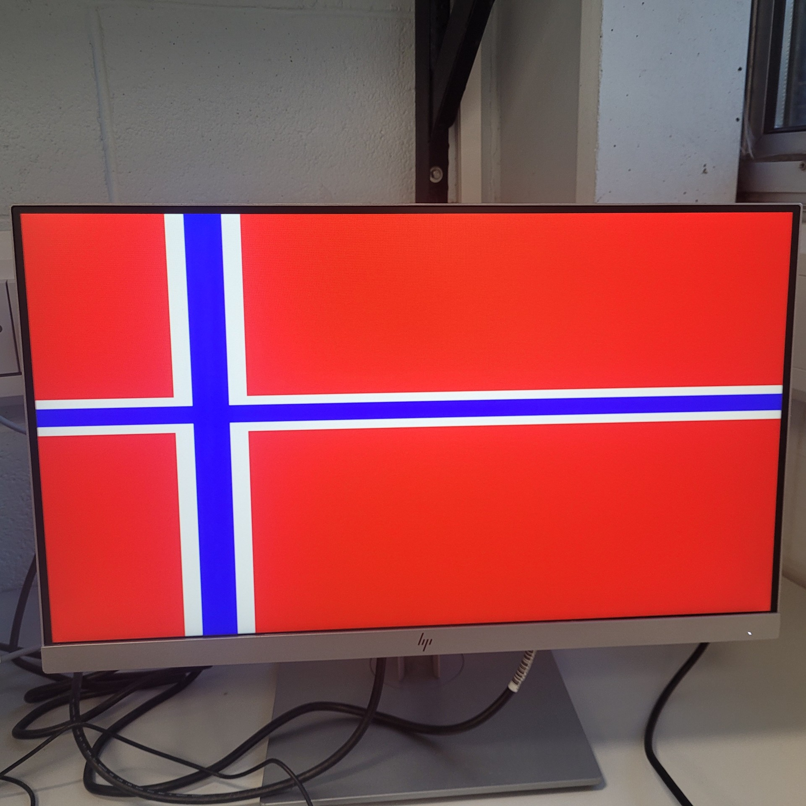
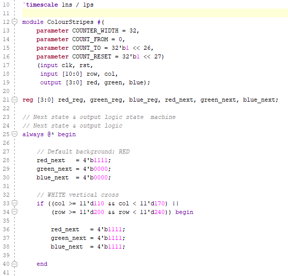
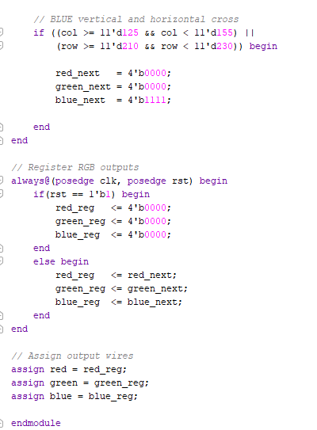
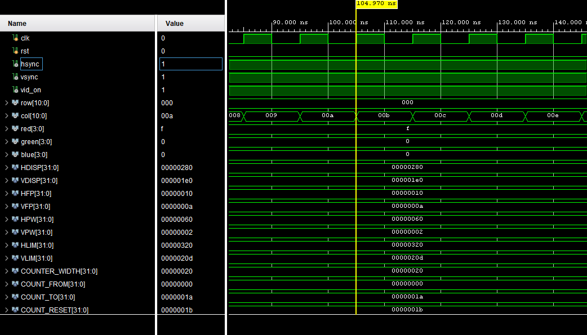
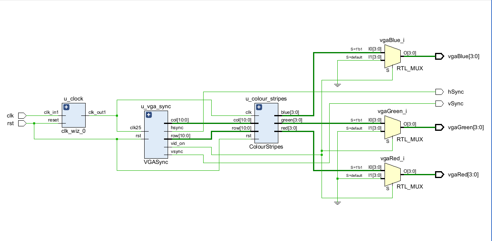
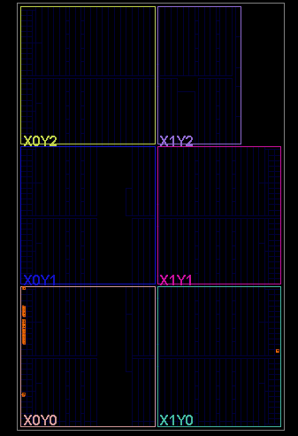
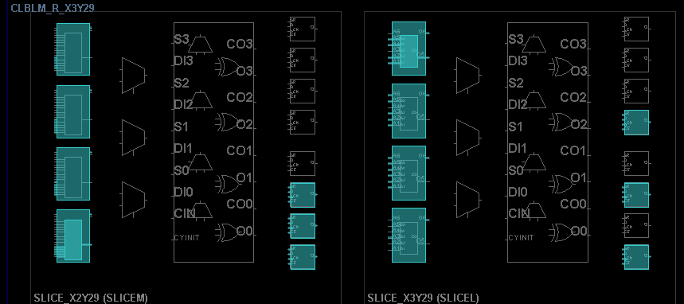
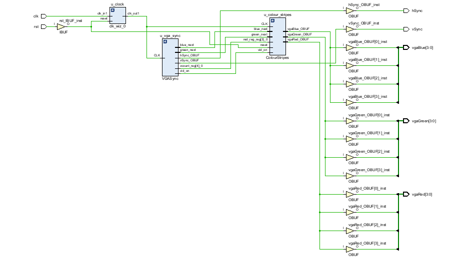

## **Welcome to my SOC Project repo**
This repository documents my System on Chip project. I started from a template that draws colour stripes on a VGA monitor and altered the template code to display the Norway national flag.

## **Template VGA Design**
The goal for the first few weeks was developing an understanding of Vivado and how we could use it to program the VGA monitor and physical board (Basys3). To achieve this everyone was given template code of colour stripes which produced a similar output to the image attached below (taken from internet). I altered this code to produce only blue and white stripes on the VGA monitor. This template exercise was for us to gain understanding in how the code ran before we dived into the main project.

## **Project files**
The project consists of the following files each providing their own function:

- **VGATop.v** - Called top since it is the top level. It wires the clock, the sync and colour block together. Also provides connectivity to the physical board pins.
- **VGASync.v** - Keeps tabs on where the beam is by holding the column and row counters and by producing the horizontal and vertical sync pulses.
- **ColourStripes.v** - Only file altered from the template, decides the current colour of the pixel from its column and row.
- **TestBench.v** - TestBench drives the clock and reset so that we can simulate without a physical board.
- **Basys3.xdc** - Constraints file that maps each signal to a real pin on the board.

### **Project Set-Up**
To setup my project I used Vivado which was connected to Basys3 board. I configured Vivado to use the Artix-7 product family and the appropriate product part. The files I added were VGATop, VGASync, VGAColourStripes, Testbench and the constraints file Basys3_Master.
Project flow:
Simulate code -> Synthesis -> Implementation -> Generate BitStream -> Program Board.

### **Template Code**
Consists of two main parts.
- One part works out where the beam is on the screen. It does this by counting the pixels across each line and lines down each frame. Sync pulses tell the monitor when the frame ends.
- The other part is 'ColourStripes' this decides what colour each pixel should be.

VGA monitor has no memory of the picture. It only draws one pixel at a time starting from the top left until it completes at the bottom right.
Every line needs a horizontal sync pulse and every frame needs a vertical sync pulse. This is an area where the screen must be **black**.
ColourStripes takes the current column and row as inputs and outputs 4-bit red, green and blue values (RGB).
The template code splits all 640 pixels into 8 even blocks of 80 and gives each block a different colour which creates the vertical bars.
These values are stored in registers on each clock edge.

### **Simulation**
The testbench drives the clock and reset. The waveform shows the column counter stepping through each pixel, the row counter steps through each line and the sync signals pulsing at the end of each line and frame. This confirms timings are correct before proceeding onto synthesis.

### **Synthesis**
Synthesis turns the Verilog into a list of logic gates and flipflops. Implementation decides where each of these previous pieces go on the chip and checks if the signals arrive on time.
After this we generate bitstream which is a file that loads onto the physical board.

### **Demonstration**
I did not take any photos of the template analysis or outputs. 
Demonstration photo is similar in output to the photo taken from the Project setup section above (blue and white stripes).

## **My VGA Design Idea**
### **Project output on screen**

Introduce your own design idea. Consider how complex/achievable this might be or otherwise. Reference any research you do online (use hyperlinks).

What my VGA design is going to be is the Norway national flag. The reason I chose this is because national flags seemed to be a popular choice among previous/current students.
I feel as this is an achievable goal that will display knowledge into how the VGA works under the hood consisting of colour representation, screen layout knowledge and loop syntax needed to display this flag on the screen.

### **Code Adaptation**
**Briefly show how you changed the template code to display a different image. Demonstrate your understanding. Guideline: 1-2 short paragraphs.**

## **Progress timeline**

**Week1** - In week one the agenda was to get the demo working on my screen which was colour stripes. We ran through the steps involved to see the template code stripe output on the screen. I did not record an image of this but I found a similar photo from the internet of what this looked like.

**Week2** - I altered the stripe template from a vertical RGB style to display a horizontal blue and white stripe style. This was achieved by altering the original code to check the rows instead of the columns. Within this code I re-wrote 0 or 1s to align with the colours I wanted to display. For example all ones written to red blue and green would create the white colour and all ones written to blue and zeros written to red and green would create only the blue colour.

**Week3** - Absent

**Week4** - In week three I decided to create and finish the display of the Norway flag. How this was done was by coding the display to create the primary colour red for the entire screen and then add white and blue horizontal and vertical lines.

**Week5** - Final review of Github page, code explanation and adding of screenshots. No new features will be added in this session it will solely be used to fill in the report.

### **Code explanation**

### **Simulation**
Show how you simulated your own design. Are there any things to note? Demonstrate your understanding. Add a screenshot. Guideline: 1-2 short paragraphs.

### **RTL Analysis**

**Elaborated Design - Schematic**

###**Synthesis**
Describe the synthesis & implementation outputs for your design, are there any differences to that of the original design? Guideline 1-2 short paragraphs.

**Implementation**
Describe the synthesis & implementation outputs for your design, are there any differences to that of the original design? Guideline 1-2 short paragraphs.

**Schematic**

### **Demonstration**
If you get your own design working on the Basys3 board, take a picture! Guideline: 1-2 sentences.
